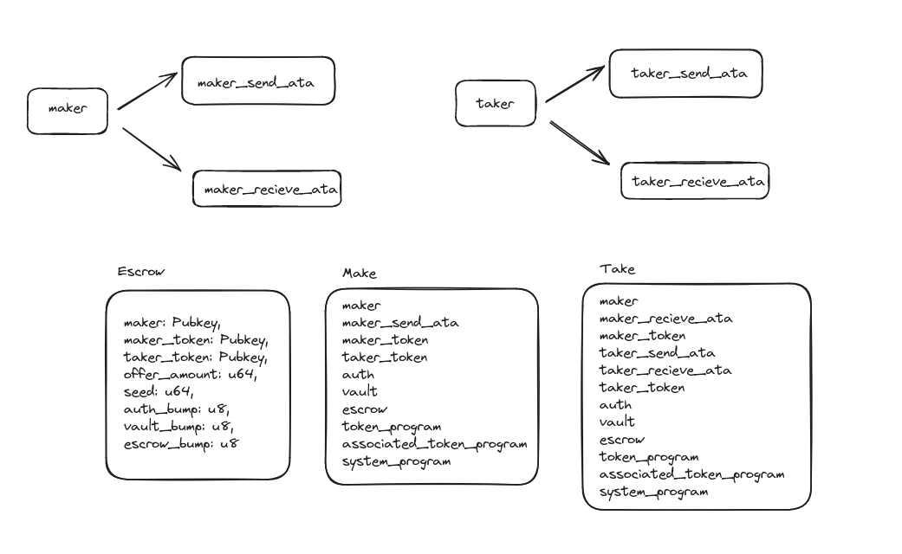
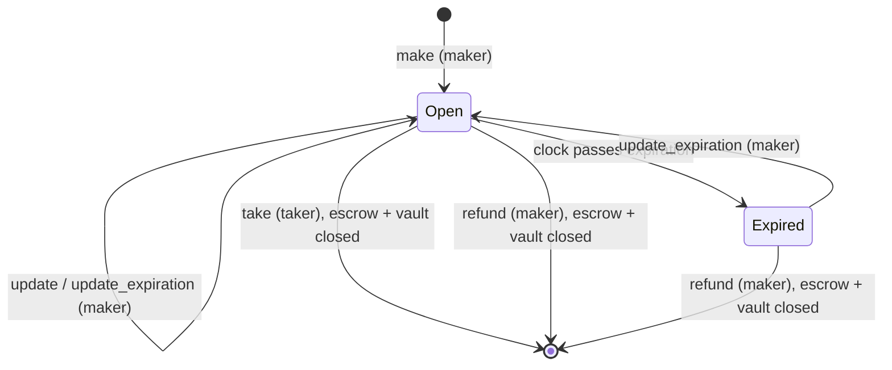
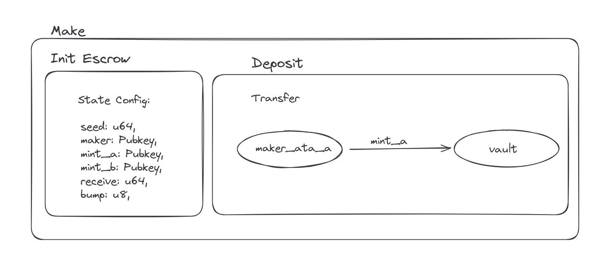
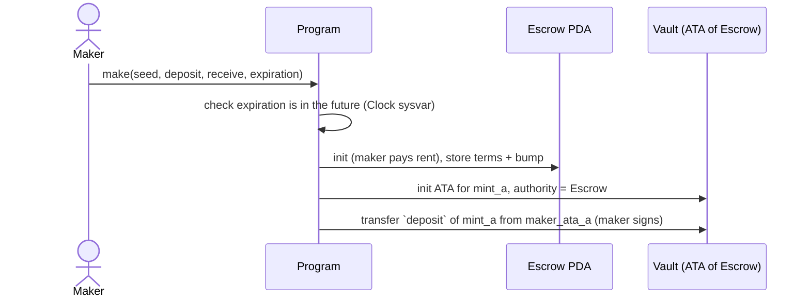
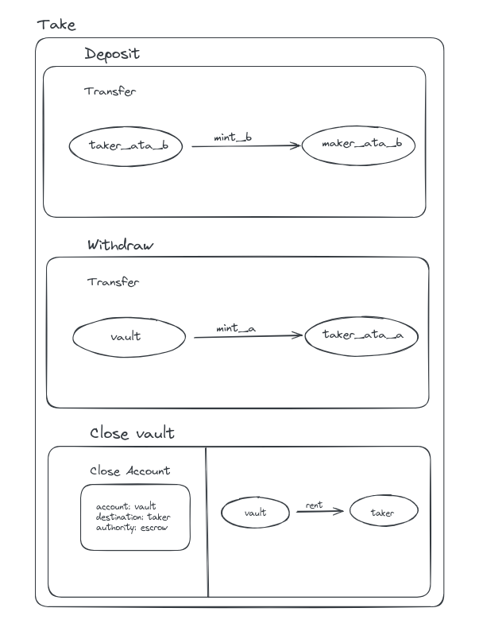
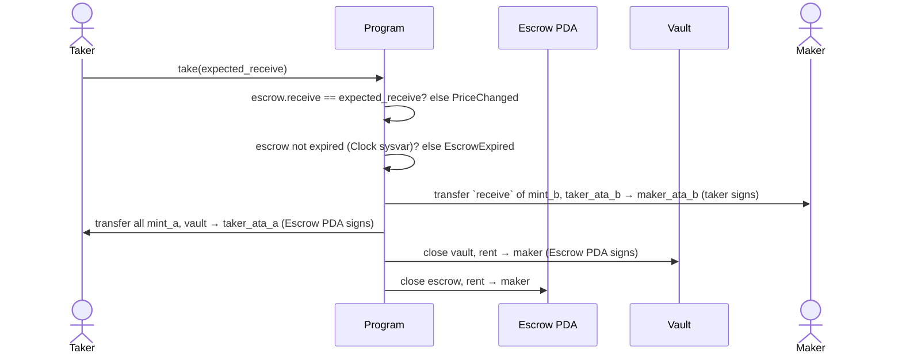
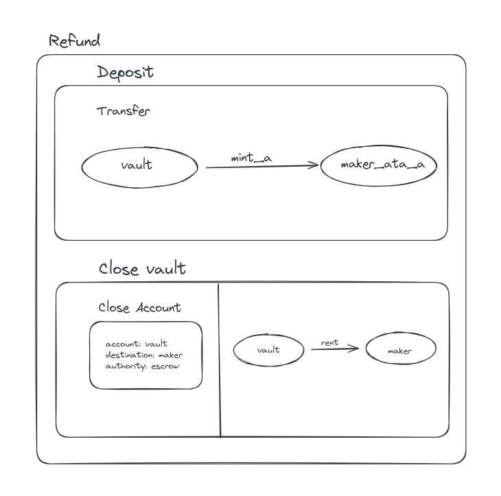
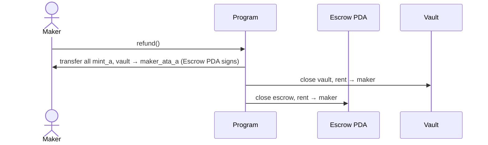
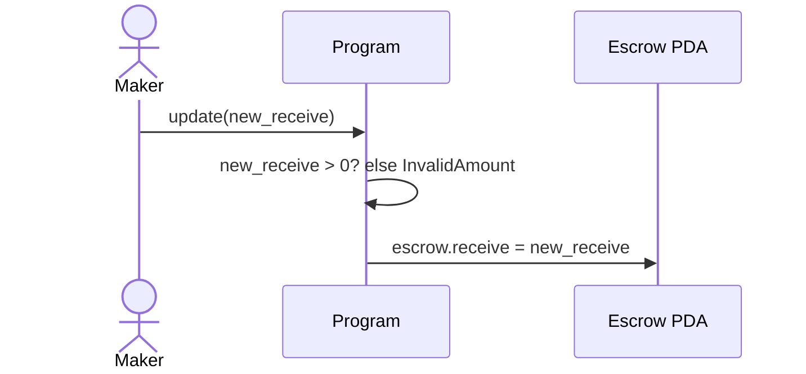
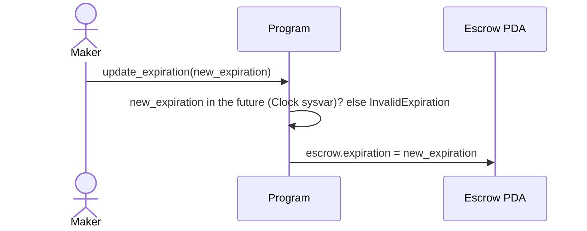

# Anchor Escrow Program

A Solana escrow for trustless token swaps, built with Anchor.

A **maker** locks Token A in a vault and names a price in Token B. A **taker** accepts by paying that price, and receives Token A in the same transaction. Neither side has to trust the other: the program only releases Token A when Token B is paid, atomically.



## Roles and accounts

| Name | What it is | Who controls it |
|---|---|---|
| **Maker** | Creates the offer, deposits Token A (`mint_a`), wants Token B (`mint_b`) | Maker's wallet |
| **Taker** | Accepts the offer: pays Token B, receives Token A | Taker's wallet |
| **Escrow** | PDA storing the offer terms. Seeds: `["escrow", maker, seed (u64 LE)]` | The program |
| **Vault** | Associated token account for `mint_a`, owned by the escrow PDA. Holds the maker's deposit | The program (escrow PDA signs) |
| `maker_ata_a` | Maker's Token A account (source of the deposit, destination of a refund) | Maker |
| `maker_ata_b` | Maker's Token B account (receives payment; created by the taker if missing) | Maker |
| `taker_ata_a` | Taker's Token A account (receives the deposit; created if missing) | Taker |
| `taker_ata_b` | Taker's Token B account (source of payment) | Taker |

### Escrow state

```rust
pub struct Escrow {
    pub seed: u64,                // lets one maker have many escrows
    pub maker: Pubkey,
    pub mint_a: Pubkey,           // token being offered
    pub mint_b: Pubkey,           // token wanted
    pub receive: u64,             // price: amount of mint_b the maker wants
    pub bump: u8,                 // canonical PDA bump, stored at init
    pub expiration: Option<i64>,  // optional Unix timestamp; None = never expires
}
```

## Lifecycle



An escrow ends in exactly one of two ways: a **take** (the trade happens) or a **refund** (the maker cancels). Both close the escrow and the vault and return their rent to the maker.

## Instruction flow

### 1. `make(seed, deposit, receive, expiration)`: maker opens an offer





- **Signer:** maker (also pays rent for the escrow and the vault).
- **Effect:** `deposit` of Token A moves from `maker_ata_a` into the vault; the escrow records the terms.
- `expiration` is optional. Pass `null` for an offer that never expires; a time in the past fails with `InvalidExpiration`.

### 2. `take(expected_receive)`: taker accepts the offer





- **Signer:** taker only. The maker does **not** need to be online; their consent was given at `make`.
- **Atomic:** both transfers happen in one instruction. If the taker can't pay, everything reverts and the vault is untouched.
- **Safety checks:**
  - `has_one = maker, mint_a, mint_b` on the escrow, so the taker can't swap in a worthless `mint_b` or point at someone else's escrow.
  - `expected_receive` is a slippage guard: if the maker changed the price after the taker saw it, the take fails instead of charging the new price.
  - An expired escrow can't be taken.
- The taker pays rent for `taker_ata_a` / `maker_ata_b` if they don't exist yet (`init_if_needed`).

### 3. `refund()`: maker cancels the offer





- **Signer:** maker.
- Works at any time, **including after expiration**, so the maker can always get their tokens back.

### 4. `update(new_receive)`: maker changes the price



- **Signer:** maker (`has_one = maker` plus the PDA seeds check).
- Takers holding the old price are protected by `take`'s `expected_receive` check.

### 5. `update_expiration(new_expiration)`: maker changes or removes the deadline



- **Signer:** maker.
- Pass `null` to remove the deadline entirely.
- Works on an **already-expired** escrow, so the maker can revive the offer instead of refunding.

## Who can do what

| Instruction | Maker | Taker | Allowed after expiry? |
|---|:-:|:-:|:-:|
| `make` | ✅ | | n/a |
| `take` | | ✅ | ❌ (`EscrowExpired`) |
| `refund` | ✅ | | ✅ |
| `update` | ✅ | | ✅ |
| `update_expiration` | ✅ | | ✅ |

## Errors

| Error | When |
|---|---|
| `PriceChanged` | `take`'s `expected_receive` doesn't match `escrow.receive` |
| `InvalidAmount` | `update` called with `new_receive = 0` |
| `EscrowExpired` | `take` called at or after `escrow.expiration` |
| `InvalidExpiration` | `make` / `update_expiration` given a time that isn't in the future |

Expiration is a Unix timestamp in seconds, compared against `Clock::get()?.unix_timestamp`. Validator clocks can drift by a few seconds, so use expirations of minutes or more, not seconds.

## Prerequisites
- Anchor CLI (version 0.32.1 or later) installed via AVM.
- Surfpool CLI installed (for enhanced local testing and runbooks: `brew install surfpool` on macOS, or from source [surfpool](https://surfpool.run/)).
- Solana CLI tools.
- Node.js/Yarn for tests.

## Running Tests
To run the integration tests against a Surfpool local validator:

1. In one terminal window, start Surfpool in your project directory:
`surfpool start`
This launches a local Surfnet validator and deploys your program.

2. In a new terminal window (in the same directory), run the Anchor tests against it:
`anchor test --skip-local-validator`
This will execute the tests in `tests/anchor-escrow-q4-25.ts`.

For standard local testing without Surfpool, just run `anchor test`.

The tests cover:
- make → refund
- make → take
- make → update price → stale take rejected (`PriceChanged`) → take at the new price
- make with a past expiration rejected (`InvalidExpiration`)
- make with expiration → expires → take rejected (`EscrowExpired`) → maker extends → take
- make with expiration → expires → maker refunds
- make with expiration → maker removes it (`null`) → take
